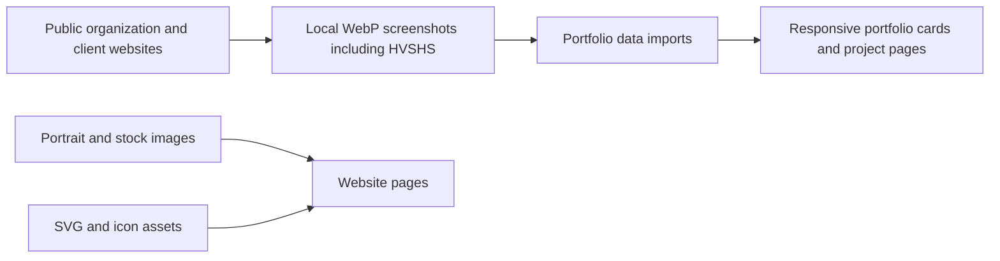

# Website assets

Local images and SVGs support the website's public pages. The website captures
include [HVSHS](hvshs.com_.webp), CXL, Graduation Source and Avanti Systems USA;
[images](images/) holds portraits and stock photography, and [icons](icons/)
holds interface assets. The HVSHS screenshot was captured from https://hvshs.com/
on November 13, 2026 at 1440 × 1000 and encoded as WebP for the portfolio.

