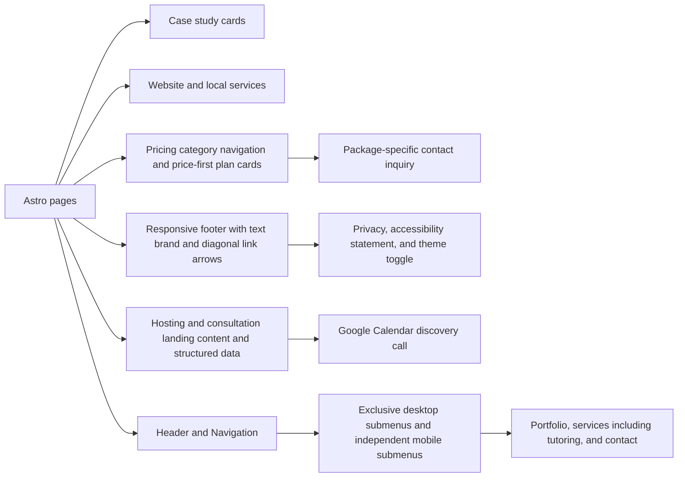

# Shared website components

[Navigation.astro](Navigation.astro) renders the brand and native menu disclosures.
The Services menu includes tutoring and mentorship.
Desktop submenus share a disclosure group, so opening one closes the previous
submenu. Mobile submenus open independently. The group updates at the 1024px
breakpoint; without JavaScript, all submenus open independently.
[navigation.css](navigation.css) supplies inline desktop links and a mobile panel
with a Menu/Close toggle, large touch targets and independent scrolling. The header
anchors the panel above page content. Other components supply shared cards,
contact panels, theme controls and page sections.

[Footer.astro](Footer.astro) closes each page with a brand block, grouped contact
and social links, and a divided copyright row with Privacy, the Accessibility statement, and a theme toggle. Footer utility and contact links share a decorative diagonal arrow. Its two-column link
grid stays readable on mobile; theme colors, visible keyboard focus and 44px link
targets support both light and dark appearances.

[ServiceLanding.astro](ServiceLanding.astro) presents a problem-first service
offer, coverage, pricing, and one repeated booking action. It emits Service
structured data referencing the site’s provider.

[ProjectGrid.astro](ProjectGrid.astro) links screenshot cards directly to case studies.
[ServiceList.astro](ServiceList.astro) presents the same website service summaries on the homepage and services index.

[PricingNavigation.astro](PricingNavigation.astro) links all six pricing categories
with service descriptions and a route-based current-page indicator.
[PricingCard.astro](PricingCard.astro) presents prices and billing terms before
features, with package-aware contact links.

