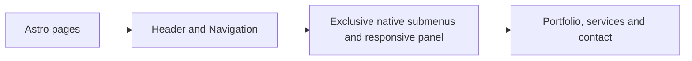

# Shared website components

[Navigation.astro](Navigation.astro) renders the brand and native menu disclosures.
Submenus share a disclosure group, so opening one closes the previous submenu
on desktop and mobile, including when JavaScript is disabled.
[navigation.css](navigation.css) supplies inline desktop links and a mobile panel
with a Menu/Close toggle, large touch targets and independent scrolling. The header
anchors the panel above page content. Other components supply shared cards,
contact panels, theme controls and page sections.

