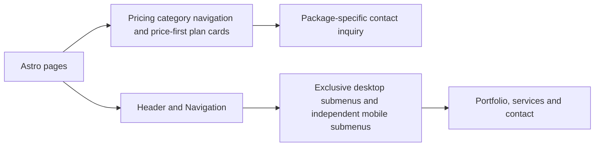

# Shared website components

[Navigation.astro](Navigation.astro) renders the brand and native menu disclosures.
Desktop submenus share a disclosure group, so opening one closes the previous
submenu. Mobile submenus open independently. The group updates at the 1024px
breakpoint; without JavaScript, all submenus open independently.
[navigation.css](navigation.css) supplies inline desktop links and a mobile panel
with a Menu/Close toggle, large touch targets and independent scrolling. The header
anchors the panel above page content. Other components supply shared cards,
contact panels, theme controls and page sections.

[PricingNavigation.astro](PricingNavigation.astro) links all five pricing categories
with service descriptions and a route-based current-page indicator.
[PricingCard.astro](PricingCard.astro) presents prices and billing terms before
features, with package-aware contact links.

