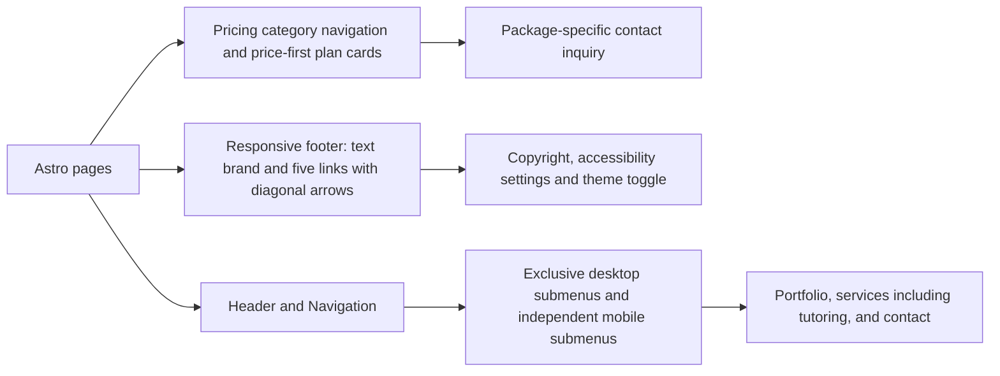

# Shared website components

[Navigation.astro](Navigation.astro) renders the brand and native menu disclosures.
The Services menu includes computer tutoring for children.
Desktop submenus share a disclosure group, so opening one closes the previous
submenu. Mobile submenus open independently. The group updates at the 1024px
breakpoint; without JavaScript, all submenus open independently.
[navigation.css](navigation.css) supplies inline desktop links and a mobile panel
with a Menu/Close toggle, large touch targets and independent scrolling. The header
anchors the panel above page content. Other components supply shared cards,
contact panels, theme controls and page sections.

[Footer.astro](Footer.astro) closes each page with a brand block, grouped contact
and social links, and a divided copyright and accessibility settings row. Contact, Email, GitHub, LinkedIn, and Accessibility share a decorative diagonal arrow. The footer brand link uses text. Its two-column link
grid stays readable on mobile; theme colors, visible keyboard focus and 44px link
targets support both light and dark appearances.

[PricingNavigation.astro](PricingNavigation.astro) links all five pricing categories
with service descriptions and a route-based current-page indicator.
[PricingCard.astro](PricingCard.astro) presents prices and billing terms before
features, with package-aware contact links.

