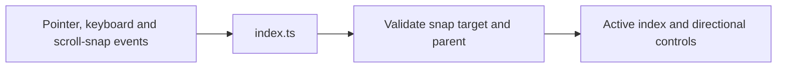

# Scroll component

[index.ts](index.ts) supplies the Lit carousel, keyboard controls and scroll-snap
index tracking. Snap events are checked for an element target with a parent
before updating the index and directional controls; null targets are ignored.

