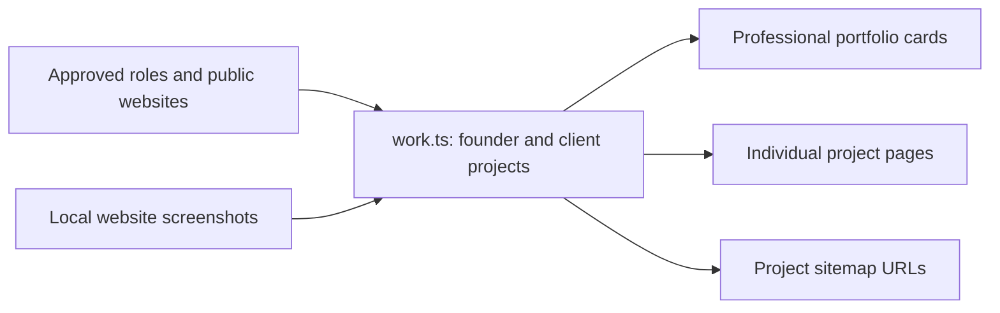

# Portfolio data

[work.ts](work.ts) supplies professional portfolio cards, individual work pages,
and sitemap routes. Entries describe Andrew's role, verified contributions,
website links and local screenshot imports. Hudson Valley Smart Home Solutions
is a founder-led organization alongside prior client contributions.

