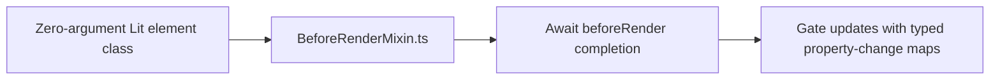

# Lit mixins

[BeforeRenderMixin.ts](BeforeRenderMixin.ts) gates Lit updates until asynchronous
pre-render work completes. Its zero-argument constructor contract retains the
base class API, and update hooks accept Lit property-change maps.

