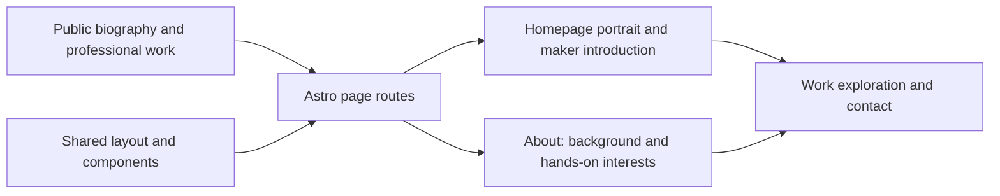

# Website pages

Astro routes provide the public website’s server-rendered content. The
[homepage](index.astro) introduces Andrew through his portrait, work, and early
maker projects; [About](about.astro) connects that work to his background and
interests. Other routes cover services, portfolios, writing, contact, and demos.
Shared layouts and components provide navigation, themes, imagery, and actions.
Keep public biographical copy grounded in approved facts and existing site content.

