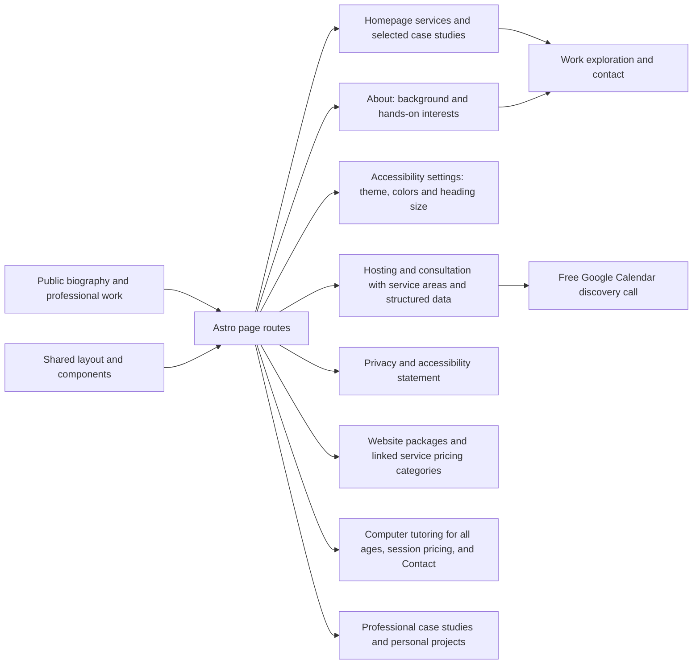

# Website pages

Astro routes provide the public website’s server-rendered content. The
[homepage](index.astro) introduces Andrew’s web services and links directly to selected
case studies; [About](about.astro) connects that work to his background and
interests. [Accessibility settings](settings.astro) groups theme, color and heading-size controls. The [services index](services.astro) groups website services and local support.
The [portfolio](portfolio.astro) links straight to professional case studies and personal projects.
[Contact](contact.astro) presents booking and email together and retains package inquiry context.
[Pricing](pricing.astro) introduces website packages and links the four service
pricing routes through a shared category selector. Shared layouts and components provide navigation, themes, imagery, and actions.
[Computer tutoring](services/tutoring.astro) uses the service hero and contact panel to introduce beginner topics for all ages and show the $100 one-hour rate and link to Contact. See the [service routes guide](services/_readme.md).
[Hosting](hosting.astro) and [consultation](consultation.astro) provide focused
landing pages with service-area details, Service structured data, and a shared
discovery-call action. The homepage declares the person and local web-service
business in structured data. [Privacy](privacy.astro) describes preferences
and appointments, while [Accessibility](accessibility.astro) covers site features
and access requests. The XML sitemap includes the four new public destinations.
Keep public biographical copy grounded in approved facts and existing site content.

