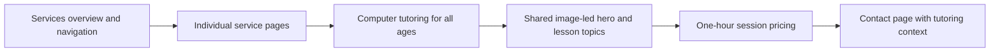

# Service pages

These routes explain individual services and connect visitors to pricing or an
inquiry. [Computer tutoring](tutoring.astro) introduces computer basics,
Scratch, and beginner Python for all ages. The shared service layout includes
an image-led hero, lesson cards, a pricing section showing $100 per one-hour
session, and a closing contact panel that routes to Contact with tutoring
selected.

