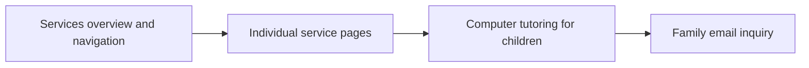

# Service pages

These routes explain individual services and connect visitors to pricing or an
inquiry. [Computer tutoring](tutoring.astro) introduces computer basics,
Scratch, and beginner Python, with a direct email link for parents and guardians.

