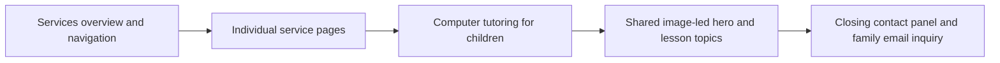

# Service pages

These routes explain individual services and connect visitors to pricing or an
inquiry. [Computer tutoring](tutoring.astro) introduces computer basics,
Scratch, and beginner Python. It uses the shared image-led hero and closing contact panel for parent and guardian inquiries.

