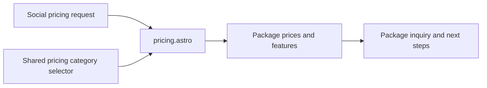

# Social pricing route

[pricing.astro](pricing.astro) renders the social packages, existing prices,
features, and next steps. Shared pricing navigation lets visitors compare all
five services and identifies the current category. The parent service route
explains the service; this directory owns its pricing page.

