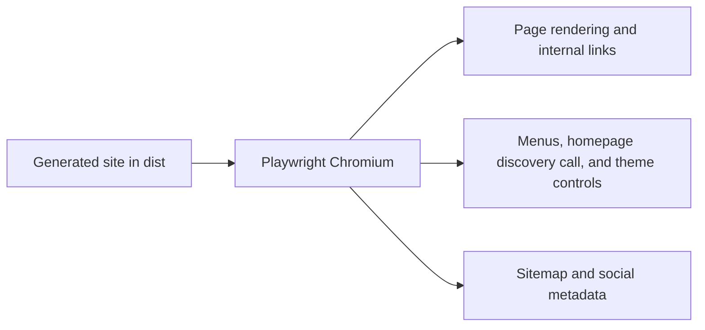

# Website browser tests

[site.spec.ts](site.spec.ts) checks the built public routes in Chromium.
It exercises internal links, narrow layouts, keyboard and no-JavaScript
navigation, theme settings, and generated metadata. Homepage navigation
checks use the discovery-call link in the hero.

